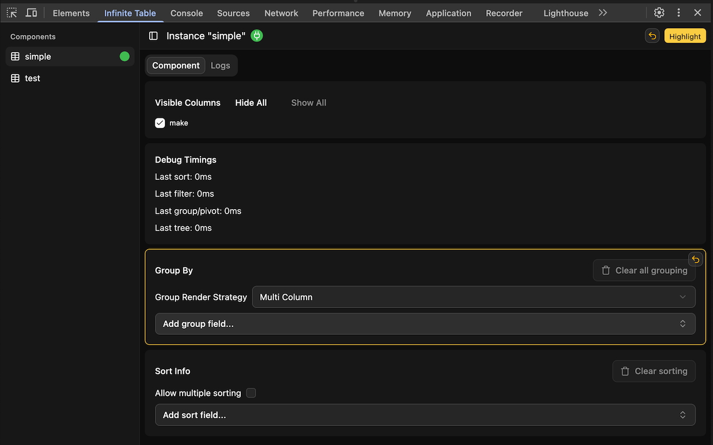

We're happy to announce that [Infinite Table DevTools extension](https://chromewebstore.google.com/detail/infinite-table-devtools-e/jpipjljbfffijmgiecljadbogfegejfa) is now live - [install it here!](https://chromewebstore.google.com/detail/infinite-table-devtools-e/jpipjljbfffijmgiecljadbogfegejfa)


To see the extension on a live demo, head to the [chrome webstore](https://chromewebstore.google.com/detail/infinite-table-devtools-e/jpipjljbfffijmgiecljadbogfegejfa) to download the extension.

Then visit [our live demo page](/demo) and open your browser devtools - you should see the "Infinite Table" devtool tab. Click it and enjoy interacting with the DataGrid!


<Note>

To see an Infinite Table instance in the devtools, specify the <PropLink name="debugId" /> prop.


```tsx file="devtools.snippet.tsx" region="intro"
```

</Note>

Infinite Table is the first DataGrid with a Chrome DevTools extension. Starting with version `7.0.0` of Infinite, you can specify the `debugId` property on the `<InfiniteTable />` instance and it will be picked up by the devtools.


```tsx file="devtools.snippet.tsx" region="intro-2"
```

<Note>

If you have multiple instances, each with a unique `debugId` property, they will all show up
</Note>


